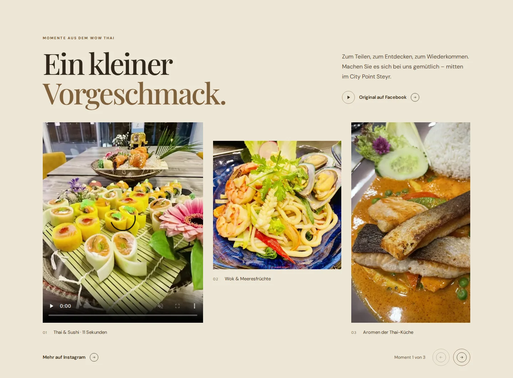

# Homepage atmosphere research — 21 October 2026

## Brief and evidence boundary

The owner likes the existing site but finds it old and dry, and explicitly wants richer media and motion. [Kei](https://restaurant-kei.fr/) and [NKORA](https://nkora.co.uk/) are the primary taste references. The chosen direction is a warm, alive, modern restaurant homepage led by images, retaining Playfair Display, DM Sans, equal 48px Hero actions, and the established reservation layout.

This record separates browser observations, primary-source descriptions, and recommendations. Desktop inspection covered Kei, NKORA, Gourou, Dishoom, Mizlala, and Pinza. Fuga and Sunday in Brooklyn were checked through primary page content. Reference mobile behavior and conversion performance were not comprehensively tested. Awards apply to dated submissions, not automatically to today's site. The agreed implementation scope below is not a deployment claim; see [COORDINATION.md](../COORDINATION.md) for delivery evidence and [DESIGN.md](../DESIGN.md) for durable rules.

## What the preferred references contribute

**Kei.** The live page showed a full-bleed muted film, approximately 152 seconds long, followed by black negative space and close food photography. Its short chapters lead to menus and the team, with a named reservation action. The transferable qualities are photographic scale, pacing, and confidence in empty space. The film's length is an observation, not a target for WoW Thai. A neighborhood restaurant still needs direct food, booking, and visit information. Source: [Restaurant Kei](https://restaurant-kei.fr/).

**NKORA.** The live Hero played a muted clip of approximately 10.77 seconds, showing barista/interior scenes. Olive and cream surfaces, large copy, a portrait photograph, and a broad image carousel followed. Its [designer's case study](https://monopo.london/work/nkora-coffee/), dated 23 September 2025, explains the coherent concept: a contemplative walk with coffee. Lino-print illustrations, the Miles mascot, customized typography, and warm film photography belong to that idea. WoW Thai can borrow the consistency between media, type, and motion while expressing its own food and hospitality. NKORA's custom type and mascot are not assets to transplant.

## Six additional restaurant references

This is a relevance shortlist, not a new ranking. “Observed” means inspected in the browser; “source” means stated or exposed by the primary page.

| Reference | Evidence and recognition | Useful adaptation for WoW Thai |
| --- | --- | --- |
| [Gourou](https://www.gourouindianfood.fr/) | Observed cream/blue composition, bold lettering, and poster frames. The accessible tree reported unavailable media, so successful film playback was not established. Its source pairs reservation/takeaway with photographed, named dishes. [Awwwards](https://www.awwwards.com/sites/gourou-indian-food) records **Honorable Mention, 17 February 2026**, not Site of the Day; the listing was available through authoritative search, while direct fetches timed out. | Strongest operational fit: expressive food photography and two clear service choices. Keep decorative detail and bilingual density proportionate to a German neighborhood-restaurant page. |
| [Mizlala](https://mizlala.com/) | Observed peach surfaces, dark uppercase type, a large staggered wordmark, overhead food spreads, and eight named dishes in a consistent four-column desktop gallery. No video elements were found during inspection. Its [order page](https://mizlala.com/order) exposes pickup/delivery by location. A newsletter modal interrupted browsing. | Adopt consistent food photography and a simple order route. Use suitable plated-food presentation and omit an interrupting newsletter popup. No design award was verified. |
| [Pinza](https://pinza.com/) | Observed cyan/yellow/green, condensed headings, oversized cutout food, diagonal type bands, and four staggered portrait videos actually playing muted. The [menu](https://pinza.com/food-menu) exposes search and food categories. [Orpetron](https://orpetron.com/sites/pinza-its-not-pizza-its-pinza/) records **Site of the Day, 4 July 2025**, score 8.6. Its July roundup does not establish a Site of the Month award. | A useful reference for greater energy: one food detail, clip, or expressive crop. Multiple simultaneous videos and pervasive moving typography would compete with WoW Thai's practical actions. |
| [Dishoom](https://www.dishoom.com/) | Observed a centered film treatment and restrained serif typography. Primary content combines food/culture stories with menu and table actions. [Locations](https://www.dishoom.com/locations/) pair individual stories with practical access details. [Awwwards](https://www.awwwards.com/sites/dishoom) records **Site of the Day, 10 January 2015**; this is historical recognition. | Show food together with real preparation, people, and place. Keep the story short enough for one restaurant instead of reproducing a large editorial universe. |
| [Fuga](https://fugafamily.com/) | Primary content presents individual destinations through images, short descriptions, and reservation routes. Live motion was not verified in this research. Included in the Elias article; no separate design award was established. | Alternate a food image with genuine place imagery when available. The group's multi-property discovery and event structure is unnecessary here. |
| [Sunday in Brooklyn](https://www.sundayinbrooklyn.com/) | Primary content exposes menus, reservations, to-go ordering, a 17-slide gallery, address, and service-specific hours. Autoplay, transitions, and mobile controls were not verified. No design award was established. | Keep practical routes explicit alongside generous imagery. Use a smaller, purposeful gallery and preserve WoW Thai's own canonical service distinctions. |

The requested [Elias article](https://www.elias.studio/en/blog/post/les-30-meilleurs-site-internet-de-restaurant) is an agency-curated 2025 inspiration list, including the agency's Fuga work. It is useful for discovery, not measured evidence of mobile usability, sales, or conversion. Its displayed update date, “5/7/2026”, was not interpreted beyond that literal format.

## Agreed implementation scope

Add one cream editorial section immediately after the existing Hero. Its oversized, short German headline is **“Ein kleiner Vorgeschmack.”** A three-slide gallery combines a verified WoW film and two food photographs, with manual swipe/arrow navigation and concise captions. The first slide plays a local, audio-free MP4 on visitor action, with native controls, `playsinline`, `preload="none"`, and the genuine poster. Playback pauses offscreen or when the page becomes hidden. Retain a link to the original Facebook post; do not autoplay the film or advance the gallery automatically.

Finite reveals use at most 12px movement over 350ms and respect reduced motion. Content remains visible without JavaScript. The existing dark menu section, managed names/prices, canonical hours, Monday sushi distinction, and reservation layout remain the functional foundation. No business-data change or architecture migration is part of this visual work.

## Selected media and provenance limits

The following preview is an actual desktop render of the new editorial
section in the local test environment. The film is paused on its genuine
poster; the screenshot is UI evidence, not evidence of a live deployment.

The [City Point tenant page](https://citypoint.at/shops/wow-thai-restaurant/) links the restaurant's official social profiles. A shared brand account still requires branch-specific evidence for place photography.

| Selected media | Public source and verified limits |
| --- | --- |
| Food film and sushi-style platter poster, 720 × 1280 | [Official Steyr–City Point film post](https://www.facebook.com/wowthairestaurant/videos/wow-thai-restraurant-steyr-city-point/825142112695835/). Public-browser playback verified moving frames, a 10.755-second duration, and a displayed post date of 8 November 2023. The source MP4 was 1,804,401 bytes; the local H.264 encode is 706,193 bytes, 10.750 seconds, with faststart and no audio stream. Capture date is unknown. Account for the poster's baked-in bands when cropping. |
| Seafood/noodle bowl, 600 × 600 | [Official City Point Steyr post](https://www.facebook.com/wowthairestaurant/posts/city-point-steyr-steyr-restaurant/358323823376422/), indexed as 8 November 2023. Capture date is unknown. This preview suits a modest gallery panel, not a wide desktop Hero. |
| Fish, rice, and vegetables, 3024 × 4032 display | [Tourism gallery](https://www.360alpenland.com/oesterreich-gastronomie/detail/430008762/wow-thai-restaurant.html), original image 193370, explicitly credited © WoW Thai Restaurant. Embedded capture date is 25 October 2021; camera metadata was not independently verified. Use as historical general food imagery, without a named-product or current-availability claim. |

Earlier ordinary-HTML inspection exposed only the film poster. Subsequent public-browser playback and download resolved that retrieval limitation without signing in.

None of these assets establishes a managed product ID, price, species, or exact recipe. Older 2021 interiors cannot establish the present City Point setting and are excluded. A separate candidate interior has unresolved publisher attribution and is also excluded. No asset from another restaurant is copied.

## Design repositories and local skill findings

The reviewed [awesome-design-md snapshot](https://github.com/VoltAgent/awesome-design-md/tree/3b605329240ce735b510037cca322f1831fdd7f8) contains **84 `DESIGN.md` files**. The reviewed tree contains no shipped images, video, preview HTML, CSS, or JavaScript components. Its useful references are [RunwayML](https://github.com/VoltAgent/awesome-design-md/blob/3b605329240ce735b510037cca322f1831fdd7f8/design-md/runwayml/DESIGN.md) for cinematic composition, [Oura](https://github.com/VoltAgent/awesome-design-md/blob/3b605329240ce735b510037cca322f1831fdd7f8/design-md/oura/DESIGN.md) for warm editorial hierarchy, and [Starbucks](https://github.com/VoltAgent/awesome-design-md/blob/3b605329240ce735b510037cca322f1831fdd7f8/design-md/starbucks/DESIGN.md) for real-product imagery and clear actions. These are analyzed design descriptions, not reusable asset packages.

[UI UX Pro Max upstream](https://github.com/nextlevelbuilder/ui-ux-pro-max-skill/tree/3eccfd8d77488577f684235a14197b8e6eed3a96) reported version **2.15.0**. The task's repository comparison found all 46 supporting runtime files equivalent to the existing local copy, plus `SKILL.md` equivalent after command-path normalization: 47 files total. No new installation was needed. The local “restaurant food service” query produced a generic red/green, three-step funnel direction, which was rejected as a mismatch to the owner's taste. Spacing, photography, and reduced-motion guidance remained useful. There is no WordPress-specific stack prescription here and no reason to migrate the theme to React.

## Future capture brief — recommendation, not implemented

Capture a real **6–12 second** preparation or current-interior sequence at the Steyr restaurant: hands finishing a dish, a brief wok or plating detail, and an inviting table or service moment. Compose both landscape and portrait versions, with a strong still poster and no essential copy baked into the footage.

Use a compressed, muted, inline film with a persistent pause control, static reduced-motion alternative, and explicit dimensions. Start with a 2 MB mobile-clip budget, then assess image quality and actual transfer size. Load secondary media when needed; prioritize the opening poster. [web.dev's video guidance](https://web.dev/articles/lazy-loading-video) distinguishes secondary lazy loading from above-the-fold/LCP media. [W3C Pause, Stop, Hide](https://www.w3.org/WAI/WCAG22/Understanding/pause-stop-hide.html) explains controls for automatic movement lasting over five seconds; [Animation from Interactions](https://www.w3.org/WAI/WCAG22/Understanding/animation-from-interactions.html) supports disabling nonessential motion. Validate mobile cropping, keyboard access, no-JavaScript content, and the unchanged ordering/reservation routes against the actual implementation.
